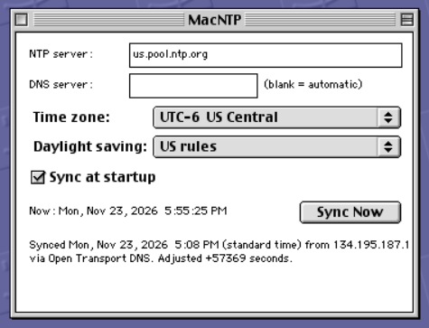

# MacNTP

**Set a classic Macintosh's clock from an internet time server (NTP).**
A control panel for System 7 through Mac OS 9, on 68k Macs and Power Macs, built in 2026 with modern tools.



## Features

- **MacNTP control panel**: NTP server, DNS server (blank = automatic), time zone,
  daylight saving (US, EU or none), *Sync at startup*, **Sync Now**, a live clock and the last result.
- **MacNTP Startup** (in Startup Items) syncs the clock every time the Mac starts.
- Uses **Open Transport's own DNS** (and the DNS server it got from DHCP) when available, with a
  built-in DNS client as a fallback, so names like `pool.ntp.org` just work.
- Asks **every server address at once** and uses the first answer, so a dead server in a pool
  doesn't slow it down.
- **Automatic daylight saving time** (US and EU rules, checked against the tz database for 2007–2039).
- Starts with the **time zone from the Map control panel**, so a new install is usually right
  without changing anything.
- Sets the clock directly, so it works **past 2019**, which System 7's Date & Time control panel can't do.
- **MacNTP Installer**: agree to the license, pick a disk, click Install. Files go into Control Panels and Startup Items
  (found with `FindFolder`, so renamed or localized System Folders work). Remove is one click too.

## Requirements

- A 68k Mac or a Power Mac with **System 7.5** or later, up to Mac OS 9.2.2 (System 7.0/7.1 with the
  Thread Manager should also work). MacNTP is 68k code, which Power Macs run in their built-in
  68k emulator; it does so little work that native PowerPC code wouldn't be noticeably faster.
- **Open Transport** (recommended) or MacTCP, and a network connection
  (for example a BlueSCSI with Wi-Fi, an Ethernet card, or PPP)
- About 400 KB of free memory while syncing

Tested in Mac OS 9.2.1 (QEMU, PowerPC with 68k emulation). Testing on real 68k hardware
(a Macintosh LC with a 68030 card, System 7.5.3, Open Transport 1.3) is in progress.

## Installing

1. Download **`MacNTP_v1.0_installer.bin`** from [Releases](../../releases). It's a MacBinary file:
   Fetch, Transmit, StuffIt Expander and [MacShell](https://github.com/jrobertfisher/MacShell)'s
   `ftp get` all turn it into the **MacNTP Installer** application.
2. Open **MacNTP Installer**, read the license and click **Agree**, then choose a disk and click
   **Install**.
3. Open **Apple menu → Control Panels → MacNTP**, check the settings and click **Sync Now**.

Settings are kept in `System Folder:Preferences:MacNTP Prefs`.

## How it works

| Part | What it does |
|---|---|
| `cdev.c` | The control panel: a 68k `cdev` code resource with no global variables. It edits the settings and launches MacNTP Startup in the background for Sync Now, then shows the result. |
| `startup.c` | MacNTP Startup: resolves the server name with Open Transport (or the built-in DNS client), queries NTP and sets the clock. Open Transport's client API needs an application, which is why the network work lives here. |
| `net.c` | UDP over MacTCP's `.IPP` driver (which Open Transport also provides), a minimal DNS client and an NTP client. |
| `common.c` | The preferences file, Pascal-string helpers, time zones and daylight saving rules. |
| `installer.c` | The installer: the license agreement, then the install. Both MacNTP files and the licenses are embedded in it as resources (`MNfk`/`MNdk`, `TEXT`). |
| `mpwstubs.c` | Stand-ins for MPW runtime symbols that Apple's 68k Open Transport libraries expect. |
| `icons.r`, `about.r` | Generated by `tools/make_icons.py` (an original design: a control panel with a clock): `ICN#`, `ics#`, `icl8`, `ics8`, `ICON`, and the About box picture. |
| `prototype/` | An early prototype: a single application configured with `STR` resources. |

## Building

You need:

- [**Retro68**](https://github.com/autc04/Retro68), built for 68k (`build-toolchain.bash --no-ppc --no-carbon`).
- **Apple's Universal Interfaces 3.4**, installed into Retro68. Retro68's free interfaces don't include
  Open Transport or `MacTCP.h`. Apple's license doesn't allow redistributing them, so they aren't in this
  repository. Retro68's `install-universal-interfaces.sh` and `interfaces-and-libraries.sh` can extract them
  from the MPW 3.5 Golden Master disk image (`MPW-GM.img.bin`), as described in Retro68's README.
- Python 3 (with Pillow, only if you regenerate the icons).

```sh
mkdir build && cd build
cmake .. -DCMAKE_TOOLCHAIN_FILE=$RETRO68/toolchain/m68k-apple-macos/cmake/retro68.toolchain.cmake \
         -DCMAKE_BUILD_TYPE=MinSizeRel
make
```

This produces `MacNTP.bin` (control panel), `MacNTPStartup.bin` and `MacNTPInstaller.bin`, all MacBinary.
The build sets the Finder's *hasBundle* flag (`tools/set_bundle_bit.py`) because Retro68's Rez doesn't.

Notes for anyone working with Retro68 and Open Transport on 68k:

- Apple's 68k OT libraries link only with `-Wl,-gc-sections`, plus the stubs in `mpwstubs.c`.
- Control panel message numbers come from `Processes.h` (`initDev = 0`, `macDev = 8`).
- The System 7 popup control keeps its menu in its private data (`PopupPrivateData`), not in the menu list.

## Credits

Built with [Retro68](https://github.com/autc04/Retro68) by Wolfgang Thaller.
Time from the [NTP Pool Project](https://www.ntppool.org/) by default.

## License

MIT. See [LICENSE](LICENSE). The installer shows MacNTP's license and the notices for the bits of
the C library built into it before installing (the same text as
[docs/LICENSES.txt](docs/LICENSES.txt)).
